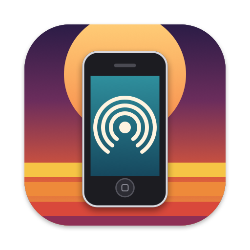
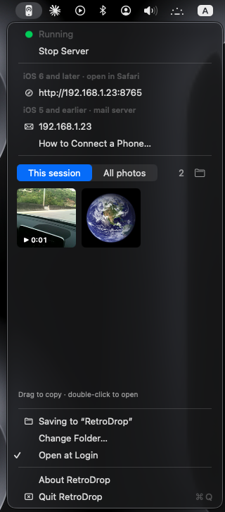

<p align="center">
  
</p>

<h1 align="center">RetroDrop</h1>

<p align="center">
  <b>Get photos and videos off old iPhones, over Wi‑Fi, straight into your Mac.</b><br>
  A free menu bar app for people who still shoot with an iPhone 3GS, iPhone 4 and friends.
</p>

---

Old iPhones take photos with a look modern phones can't fake, but getting those photos *off* them has
become a chore. iCloud and AirDrop don't work on them, modern websites refuse their old browsers,
and USB syncing needs software that no longer runs.

RetroDrop turns your Mac into a tiny server on your home Wi‑Fi that old phones *can* talk to:

- **iOS 6 and later:** open a simple web page in Safari, pick photos or videos, tap Upload.
- **iOS 5 and earlier:** "email" photos from the Photos app to your Mac. RetroDrop acts as the mail
  server and keeps the attachments. Nothing is actually emailed and nothing leaves your network.

Everything lands in a folder on your Mac, and the newest arrivals show up right in the menu bar,
ready to drag onto your desktop or into any app.

<p align="center">
  
</p>

## Features

- **Lives in the menu bar.** One click to start or stop. While it's running, the icon shows a signal.

   stopped &nbsp;&nbsp;
   running
- **Works with phones from 2007 onwards**, using the two routes above.
- **Photos and videos**, including long videos. Tested with 60 MB files.
- **A thumbnail grid in the menu.** Switch between *This session* and *All photos*, drag thumbnails out to
  copy them, or double-click to open. Videos show their length.
- **Shows your Mac's address** with one-click copy, plus a built-in "How to Connect a Phone" guide.
- **Never overwrites anything.** Old iPhones call every file `image.jpg`, so RetroDrop adds a date and
  time to each name.
- **Works over full-screen apps** like a native Apple menu.
- **No dependencies.** A single small native app for Apple silicon and Intel Macs.
- **Free and open source** (MIT).

## Which phones work?

| Phone software | How to send | Notes |
|---|---|---|
| iOS 6 – iOS 10 (e.g. iPhone 3GS, 4, 4S, 5, 5c) | **Safari** web page | Photos & videos, several at once |
| iOS 5 (e.g. iPhone 3GS, 4 that were never updated) | **Mail** | Safari can't upload files before iOS 6 |
| iPhone OS 3 – iOS 4 (iPhone 2G, 3G, 3GS) | **Mail** | Should work the same way; not yet tested, reports welcome |

Newer phones work with the Safari route too, but they have better options like AirDrop.

**Tested so far:** iPhone 3GS on iOS 6 (Safari), iPhone 4 on iOS 5 (Mail).
If you try another model, please open an issue and tell us how it went!

## Requirements

- A Mac running **macOS 14 Sonoma or later** (Apple silicon or Intel)
- The phone and the Mac on the **same Wi‑Fi network**

## Install

1. Download `RetroDrop-x.y.z.zip` from the [Releases](../../releases) page and double-click it to unzip.
2. Drag **RetroDrop** into your **Applications** folder.
3. Open it. Because RetroDrop is a free app that isn't registered with Apple, macOS will block the
   first launch. To allow it:
   - Click **Done** on the warning.
   - Open **System Settings → Privacy & Security**, scroll down, and click **Open Anyway** next to
     the RetroDrop message. Confirm with your password.
4. Look for the phone icon in your menu bar.
5. If macOS asks whether RetroDrop may **accept incoming network connections**, click **Allow**. That's
   how the phone reaches it.

## Quick start

1. Click the menu bar icon and choose **Start Server**.
2. The menu shows your Mac's address, for example `http://192.168.1.23:8765`.
3. On the phone:
   - **iOS 6 or later:** type that address into Safari, tap *Choose File*, pick photos or videos, and
     tap *Upload*.
   - **iOS 5 or earlier:** set up the Mail route once (takes two minutes), then send photos with
     *Share → Email*.
4. Photos appear in the menu and in **Pictures/RetroDrop**.

**The full step-by-step guide, including the one-time Mail setup and troubleshooting, is in
[docs/SETUP.md](docs/SETUP.md).** The same instructions are built into the app under
*How to Connect a Phone…*, with your Mac's current address filled in.

## Privacy and security

- RetroDrop only works on your local network. It never connects to the internet, has no accounts,
  and collects no data.
- The "mail server" never sends mail anywhere. It only saves attachments into your folder.
- While the server is running, **anyone on the same Wi‑Fi can send files to your RetroDrop folder**.
  There is no password, because old phones can't do modern security. Stop the server when you're done,
  and don't run it on public or shared Wi‑Fi.
- Connections are plain HTTP and plain mail protocols, because old phones can't use modern encryption.
  That's fine on a home network, but don't use RetroDrop on networks you don't trust.

## Build from source

You need Xcode (or the Xcode Command Line Tools) on macOS 14 or later.

```bash
git clone https://github.com/samir-bujawdeh/RetroDrop.git
cd RetroDrop
scripts/build.sh
open build/RetroDrop.app
```

`scripts/build.sh` produces a universal `build/RetroDrop.app` and a release zip in `dist/`.
The icons are drawn in code; regenerate them with `swift scripts/make-icons.swift`.

To run the end-to-end tests, start the app with a scratch folder and run the test script:

```bash
mkdir -p /tmp/rd-test
open build/RetroDrop.app --args --start -saveFolder /tmp/rd-test
python3 tests/test_servers.py "$(build/RetroDrop.app/Contents/MacOS/RetroDrop --print-ip)" /tmp/rd-test
```

Address detection and port fallback have their own test, which launches the app several times with
ports deliberately blocked (quit any running RetroDrop first):

```bash
python3 tests/test_network.py
```

### Project layout

```
Sources/
  App.swift          menu bar item and menu
  PhotoGrid.swift    thumbnail grid inside the menu
  Controller.swift   starts/stops the servers, watches the folder
  TCPServer.swift    small socket server
  Services.swift     web upload page, mail (SMTP/POP3) servers, file saving
  MIME.swift         extracts attachments from uploads and emails
Resources/           Info.plist, app icon, menu bar icons
scripts/             build.sh, make-icons.swift
tests/               end-to-end tests
docs/                setup guide, release guide
```

Maintainers: see [docs/RELEASING.md](docs/RELEASING.md) for making a release.

## FAQ

**Why not HTTPS?** Old iPhones can't connect to modern secure websites. That's the whole reason this
tool exists. RetroDrop is meant for your home network only.

**Does it need the internet?** No. The phone talks directly to your Mac over Wi‑Fi.

**What if another app on my Mac already uses port 8765?** RetroDrop picks the next free port
(8766, 8767, …), shows the new address in the menu, and keeps using it from then on, so bookmarks
on your phones keep working.

**Why does the Mail route use ports 25 and 110?** Those are the standard mail ports that old iPhones
try first, so setup on the phone needs no advanced settings. If another app on your Mac is using them,
RetroDrop still runs the Safari route and tells you the Mail route is off.

**My Mac's address changed and the phone can't connect.** Routers sometimes hand out a new address.
RetroDrop notices on its own: the menu and *How to Connect a Phone…* always show the current one,
picked from the network connection your Mac is actually using (VPNs and self-assigned addresses are
ignored). The phone can't update itself, though. See [docs/SETUP.md](docs/SETUP.md#keep-your-macs-address-from-changing)
for how to make it stick.

## License

[MIT](LICENSE). Free to use, share and modify.

RetroDrop is an independent project and is not affiliated with or endorsed by Apple Inc.
iPhone, Mac, Safari and AirDrop are trademarks of Apple Inc.
